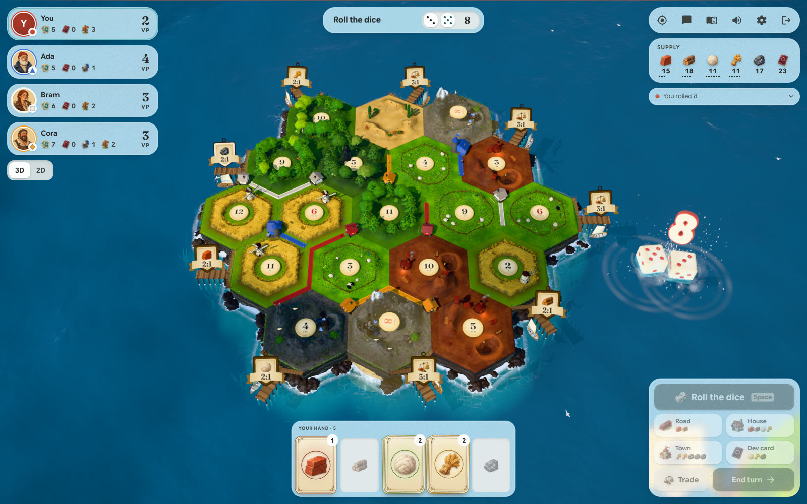
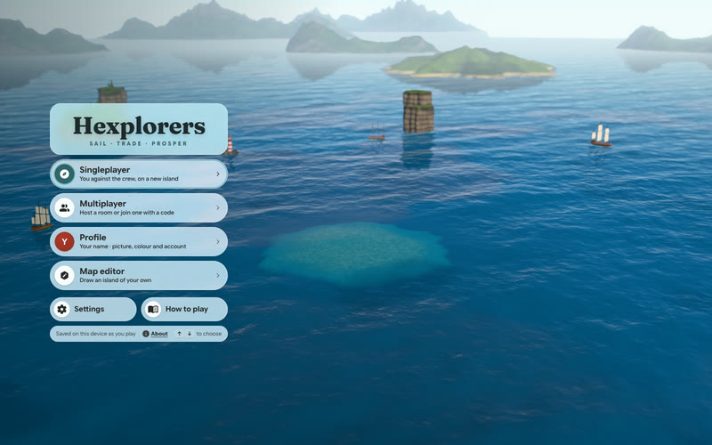
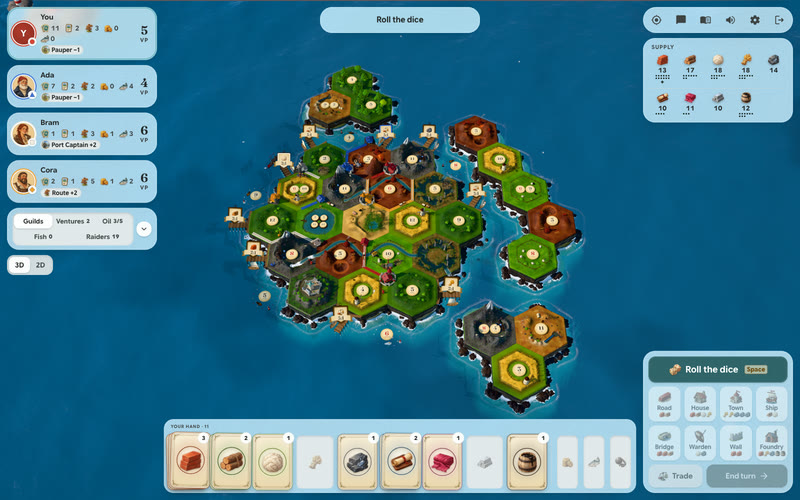
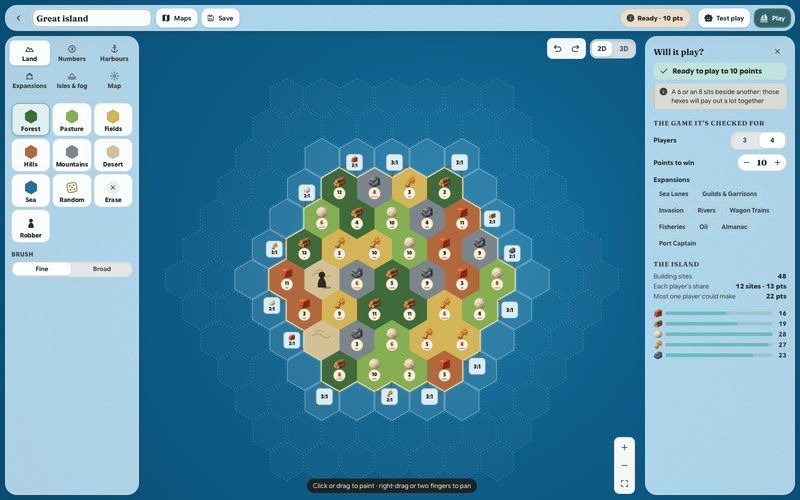
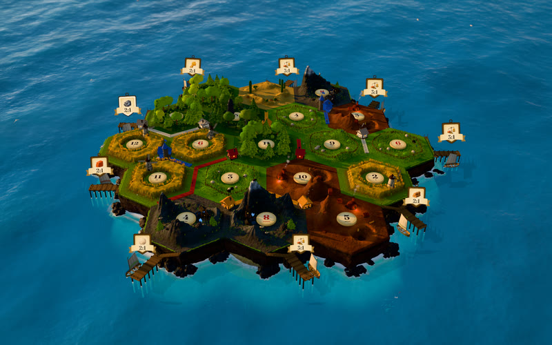

# Hexplorers

**A board game of sailing, trading and building on an island, played in the browser in 3D.** Three or four
players gather resources from the island's tiles, trade with each other and the supply, and build roads,
houses and towns toward a points target. You play against computer opponents, or online with friends in a
shared room. The island is rendered with three.js on WebGPU, falling back to WebGL2, and runs on phones as well as
desktops. Play it at [hexplorers.xyz](https://hexplorers.xyz).

Each turn you roll two dice; every tile showing that number pays its resource to the houses and towns beside it.
You spend resources on roads, houses, towns and development cards, trade the rest, and the first to the target
(10 points in the base game) wins. The How to play pages in the game, and [docs/base-game.md](docs/base-game.md),
have the full rules.



## What it does

<picture>
  <source media="(prefers-color-scheme: dark)" srcset="docs/images/game-loop-dark.svg">
  
</picture>

1. **Input**: a click on the board, a button in the HUD or a keyboard shortcut becomes a command.
2. **The rules engine** (`src/engine/`) applies it. It is pure and deterministic, and the same code runs in the
   browser for a solo game and on the server for an online one.
3. **The host** (the code that owns the game: the browser in a solo game, the room server online) returns what
   happened as events, and online only what each player's seat may see.
4. **The presenter** plays the events out: pieces land on the island, cards fly to hands, dice roll, the log and
   the panels update, and sound plays.

Nine optional expansions mix freely on the set-up page: Sea Lanes (ships, islets and fog), Guilds & Garrisons,
Invasion, Rivers, Wagon Trains, Fisheries, Oil, the Almanac of happenings and Port Captain. Five presets combine
them, with All Hands using all nine on an archipelago. Each expansion has its own pieces, terrain, rules page and
bot play. A map editor draws islands of your own, and every game saves as it goes.

| | |
|---|---|
|  |  |
|  |  |

## Quick start

Requirements: Node.js 22.13 or later, and a browser with WebGPU (current Chrome, Edge or Safari) or WebGL2.

```bash
npm install
npm run dev
```

**Play it.** `npm run dev` serves the game at http://localhost:5173, with online play's API and room sockets
running in the same process (a room is one online game). Open it, choose Singleplayer and Set sail. Multiplayer hosts a room you can join from a
second browser window.

**Run the tests.**

```bash
npm test                                      # rules, bots, every expansion mix, replays and online play
npm run test:quick                            # the same without the slowest suites
npx tsc --noEmit -p .                         # typecheck the game
npx tsc --noEmit -p tsconfig.server.json      # typecheck the server
```

On a busy machine, `TEST_TIMEOUT_SCALE=4 npm test` stretches every test's timeout (see `tests/tier.ts`).

**Build and serve it.**

```bash
npm run build                                 # typecheck and bundle into dist/
npm run server                                # builds the server, then serves dist/ with online play on port 8787
```

**URL parameters** for development and testing:

| Parameter | Effect |
|---|---|
| `?autostart` | Skip the title and start a four-player game against bots |
| `?watch` | Every seat is a bot; you watch |
| `?mix=allHands` | With `?autostart` or `?watch`: a preset (`allHands`, `longVoyage`, `siege`, `rivermouth`, `fishingArchipelago`) or a list of expansions (`sea,oil`) |
| `?seed=42` | A fixed board and dice |
| `?layout=beginner` | With `?autostart` or `?watch`: the fixed beginner island |
| `?q=low\|medium\|high\|ultra` | Graphics quality |
| `?time=0.42` | Hold the time of day (0.12 morning, 0.25 noon, 0.42 golden hour, 0.53 dusk, 0.72 night) |
| `?difficulty=easy\|normal\|hard` | With `?autostart` or `?watch`: bot strength |
| `?webgl` | Use the WebGL2 backend |
| `?perf` | A performance overlay |
| `?go=/new` | Open the singleplayer set-up page (`/multi`: the Multiplayer page) |

**Controls.** Drag to pan, right-drag or Shift-drag to turn and tilt, scroll to zoom; on a touch screen, drag to
pan, pinch to zoom and two fingers to turn and tilt. WASD pans, Q and E rotate, R and F tilt, H resets the view.
Space rolls; 1 to 4 build a road, house, town or development card, and 5 to 9 the expansions' builds; T offers
a trade, B trades with the supply; Enter ends the turn; Esc cancels; Ctrl or ⌘+Z takes back; V switches to the flat
map; P pauses; M mutes; ? opens the rules.

**Browser checks** (macOS with Google Chrome, Playwright's Chromium or `CHROME_PATH`; they drive it with WebGPU through `playwright-core`):

```bash
npm run smoke                                 # plays games in a browser against a running dev server
node scripts/capture/screens.mjs --list       # every screen at every size, with layout checks
node scripts/capture/shots.mjs --list         # screenshots of pieces and terrain for review
node scripts/capture/trailer.mjs              # records the looping trailer into public/social
node scripts/checks/online-e2e.mjs            # two browsers play a game online (starts its own server)
```

## Repository layout

```
src/
  engine/          The rules engine: pure, deterministic, no DOM; runs in the browser and on the server
    modules/       The expansions, one rule module each (docs/module-guide.md)
    maps/          The maps and how a game's board is dealt (docs/maps.md)
    ai/            The bots (easy, normal, hard)
  game/            The host, the presenter, the UI store, saves and what the table says
  render/          The three.js world: board, pieces, terrain life, sea, sky, weather and effects
  ui/              The React interface: HUD, dialogs, rules pages, the map editor and online pages
  audio/           Sound effects, ambience and music, synthesised with Web Audio
  net/, online/    Online play's protocol and the browser's client
  app/             Start-up, input, settings applied to the world, the service worker's client
  worker/          Link previews and the trailer's byte ranges for the site's Worker
  styles/          The stylesheets (glass.css is the default Sea Glass look)
server/            Online play's server: rooms, accounts, friends, ratings, push, replays (docs/online/)
  cloudflare/      The deployed runtime: the Worker and the room Durable Object
  node/            The local runtime on node:sqlite, used by npm run dev and npm run server
public/            Static files: the painted art, icons, the manifest and the service worker
tests/             Vitest suites: rules, bots, expansion mixes, golden replays, the server and online play
scripts/
  capture/         Screenshots and sound renders for review
  checks/          Browser checks: the smoke test, frame timings, load times, the online walkthrough
  run/             serve-dist.mjs serves a build the way the site does
  lib/             Finding Chrome for the scripts
  art/             The art pipeline (generation prompts, and conversion to WebP)
docs/              Rules as implemented, the expansions, maps, the map editor, online play; figures/
```

The figures in `docs/images/` are drawn from `docs/figures/*.mmd`:
`npm install --no-save pele && node docs/figures/render.mjs`.

## How it works

### Rules engine

`applyAction(state, player, action)` returns the next state and the events it produced, or an error. Everything
random comes from a seeded generator kept in the state, so a game is its seed plus its actions: a save and a replay
are that log, played again. `legalActions()` lists every legal move, which the bots and a fuzzer use.
[docs/base-game.md](docs/base-game.md) covers the rules as implemented and the choices made where rules leave room.

### Expansions

Each expansion is a module with its own state, actions, hooks into the turn and bot play, behind one contract
(`src/engine/modules/api.ts`). Any combination is allowed, with compatibility grades and twelve interaction rules
deciding how modules meet. [docs/expansions.md](docs/expansions.md) has the design, and
[docs/all-hands.md](docs/all-hands.md) and [docs/expansion-rulesets.md](docs/expansion-rulesets.md) the presets'
rules.

### Rendering

The world is three.js on WebGPU with shaders written in TSL (three.js's shading language): an FFT ocean (a simpler
wave model on WebGL2), a sky that moves through the day, animals and work on every tile, and weather. Four quality
presets trade looks for speed: Low drops ambient occlusion and bloom, and High and Ultra add depth of field, motion
blur, lamp lights, sea reflections and the full temporal anti-aliasing. The interface is React over the canvas; on WebGPU, the frosted glass behind the HUD's panels
(the in-game interface) is drawn into the frame rather than by the browser.

### Online play

<picture>
  <source media="(prefers-color-scheme: dark)" srcset="docs/images/online-dark.svg">
  
</picture>

The server holds the game, the dice and the bots, and sends each seat only what it may see. Empty seats go to the
bots, a player who drops is played by a bot until they return, and the dice are committed in advance: their key's
hash is published at the start and the key revealed at the end, so a replay can check every roll. One person hosts a
room and the others join it with its code or link, or watch from the quay. [docs/online/README.md](docs/online/README.md)
explains running it and the keys each outside service needs; [docs/online/ARCHITECTURE.md](docs/online/ARCHITECTURE.md) covers the protocol.

### Map editor

Draw an island in 2D or 3D with terrain, numbers, harbours and the robber's start, and see as you go whether a game
on it can reach its target. Maps stay in the browser and export to files, and a game carries its map whole, so saves
and replays never depend on the library. See [docs/map-editor.md](docs/map-editor.md).

## Deploying

The site is a Cloudflare Worker (`wrangler.toml`): the static build, the API and the rooms, each a Durable Object
(a small stateful server with its own storage), with accounts and other services in D1 (Cloudflare's SQLite
database). `wrangler.toml` names this project's routes and D1 database: a fork creates its own database
(`npx wrangler d1 create exploratory`) and replaces the `database_id` and the `[[routes]]` before deploying. Setup
and secrets are in [server/cloudflare/README.md](server/cloudflare/README.md).

```bash
npm run build && npx tsc --noEmit -p tsconfig.server.json && npx wrangler@4 deploy
```

A deploy restarts every live room, which comes back from storage. Each room keeps the rules version it was created
with, so a change to how a game plays is gated on the rules version (`RULES_VERSION` in `src/engine/constants.ts`);
the golden replays in `tests/`, recorded games played again and compared, catch an ungated change.

## Limits

- **Browser scripts are macOS-only as written.** They pass Chrome's Metal flag and look for Chrome in macOS's
  locations; elsewhere set `CHROME_PATH` and drop `--use-angle=metal`.
- **The art pipeline needs an image model.** `scripts/art/gen_art.py` drives the Codex CLI's image tool and writes
  full-size originals to the git-ignored `art-src/`; the repository ships only the WebP files in `public/art/`.
- **Some online services need keys.** Google, Apple and Discord sign-in and email each need their own keys; without
  them those features stay off. Push works locally without any, and a deploy sets its push keys as secrets.
- **Saved data keeps the project's working name, Exploratory.** Browser storage keys and the Worker are named
  `exploratory`, so saves and links made under that name keep working.

## License and credits

Hexplorers is made by [@_a9lim](https://x.com/_a9lim) and [@treetowntree](https://x.com/treetowntree). It is free to use, modify and share, including commercially, under the [Apache License 2.0](LICENSE), as long as you keep the credit in [NOTICE](NOTICE) in anything you distribute: the makers named above, shown where players or readers can see it (an About screen or the README). It adapts code from web-ocean and three.js, uses icons from
Lucide and Material Symbols, and bundles four open fonts; [THIRD_PARTY_NOTICES.md](THIRD_PARTY_NOTICES.md) lists each
with its license. The painted art was generated with an AI image model from the prompts in `scripts/art/`, and the
sound is synthesised in code.

Hexplorers is a hex-board resource-trading game. Its rules of play are mechanics, and
its names, text, art and code are its own. It is not affiliated with or endorsed by any other game's publisher.
